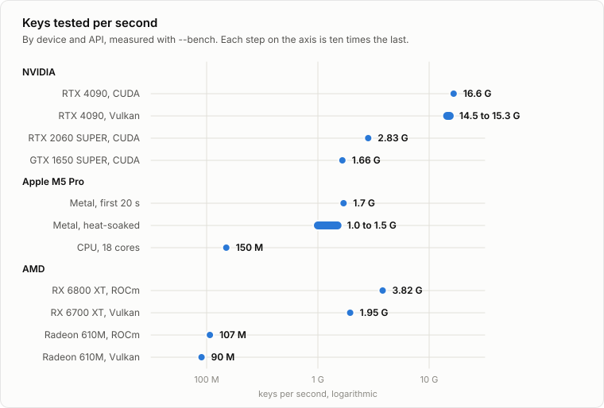
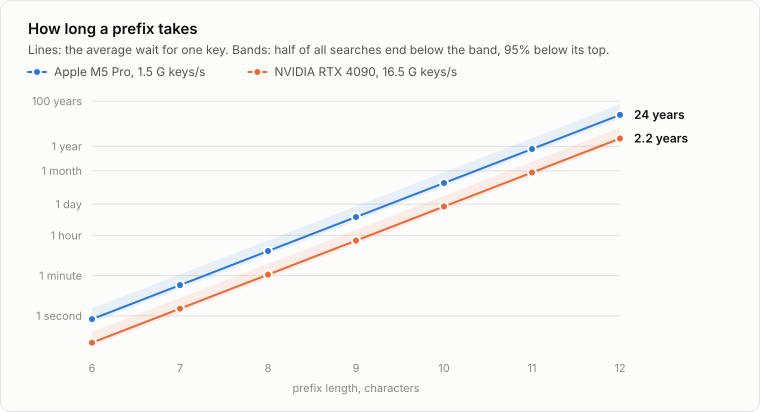

# cipollino

GPU vanity address generator for Tor v3 onion services.

- Built for GPUs: **CUDA** (NVIDIA), **ROCm** (AMD), **Metal** (Apple) and **Vulkan**
  (any vendor), on every GPU in the machine.
- Searches for any number of prefixes at once, with wildcards.
- Seeds come from the OS CSPRNG, the GPU never sees a secret, and every key is derived
  again and validated on the CPU with libsodium before it is written.

```
$ cipollino -n 2 cipoll onionz
device 0: Metal: Apple M5 Pro | 65536 threads x 2049 keys/batch | 2048 MiB scratch (lean) | self-test ok
cipollya765vqktqzicureqn6uje4pk2xn6eck3sbvfmyqwb4x77t3ad.onion
cipollwoeooqjbkoh464hoeao3pjpmfc4lpsjbbzzcpx4l4p2yn4w4id.onion
806M keys tested in 600 ms (1.34G keys/s), 2 keys found
```

Each key is a ready-to-use `HiddenServiceDir`:

```
cipollya765v….onion/hostname
cipollya765v….onion/hs_ed25519_public_key
cipollya765v….onion/hs_ed25519_secret_key      (mode 0600, directory 0700)
```

**No GPU?** The CPU backend is a fallback that runs the GPU kernel on host threads, not
a tuned CPU search. On a CPU, [Prefix32](https://github.com/0xROOTPLS/Prefix32) and
[onion-vanity-address](https://github.com/AlexanderYastrebov/onion-vanity-address) are
faster.

## Install

| system | get it |
|---|---|
| Windows | `cipollino-<version>-windows-x64.zip` from [Releases](https://github.com/Meow/cipollino-gen/releases): one program with CUDA, Vulkan and CPU |
| Linux, NVIDIA | `ghcr.io/meow/cipollino-gen` (CUDA, Vulkan) |
| Linux, AMD | `ghcr.io/meow/cipollino-gen:rocm` (ROCm, Vulkan) |
| macOS, anything else | [build it](#building) |

The images need only Docker and the GPU driver on the host (plus
nvidia-container-toolkit for NVIDIA). `latest` and `rocm` follow the main branch;
`<version>` and `<version>-rocm` are the releases. `cipollino-docker` from this repository runs one
as you, with `./keys` mounted and every GPU passed through:

```
CIPOLLINO_IMAGE=ghcr.io/meow/cipollino-gen ./cipollino-docker -n 2 someprefix
```

## Usage

```
cipollino [options] PREFIX [PREFIX...]

  -n, --count N       stop after N keys (default 1; 0 = run until interrupted)
  -d, --dir DIR       where to create the <address>.onion directories (default .)
  -f, --file FILE     read more prefixes from FILE, one per line
  -b, --backend NAME  auto (default), cuda, rocm, metal, vulkan or cpu
      --devices LIST  devices to use, numbered as the backend lists them, e.g. 0,2
      --threads T     kernel threads per device
      --pairs N       pairs per batch; a batch tests 2N+1 keys per thread
      --scratch MODE  auto, full, lean or half
      --arith MODE    auto, wide or narrow
      --filter MODE   auto or bitmap
      --launch-ms MS  target duration of one kernel launch
      --bench [SECS]  measure throughput, write nothing
      --tune          try thread counts, scratch modes and arithmetics; print the fastest
      --selftest      cross-check the backend against libsodium exhaustively
      --verify [DIR...]  check key directories instead of searching
  -q, --quiet         print only the addresses found
  -V, --version
```

Prefixes use the onion alphabet (`a-z`, `2-7`); upper case and a trailing `.onion` are
accepted. Addresses go to stdout, everything else to stderr. The exit status is 0 when
the requested number of keys was found and 130 when interrupted first.

**Wildcards.** In a prefix, `?d` stands for a digit (`2-7`), `?l` for a letter and `?a`
for either: `cipollino -n 3 'onion?d?d' 'my?lsite'`. Quote them, as `?` means something
to the shell.

**Estimates.** The progress line ends in `1 key per 6.5 h (50% within 4.5 h, 95% within
19.5 h)`: the average wait at the current rate, and the waits that half and 95% of all
searches stay under. The search has no memory, so the estimate always counts from now.

**Checking keys.** `--verify` checks each `DIR`, or every `<address>.onion` inside it
(default: inside `--dir`), whoever wrote it: Tor's file headers and lengths, the public
key against the secret scalar, that it is a canonical point of the prime-order group, a
signature round trip, and `hostname` against the key. File modes open to other users and
an unclamped scalar are reported as notes. The exit status is 1 if a directory fails.
Damage to the second half of the secret key (the nonce prefix) cannot be detected:
nothing public depends on it.

## Performance

<picture>
  <source media="(prefers-color-scheme: dark)" srcset="docs/speed-dark.svg">
  
</picture>

| device | backend | keys/s |
|---|---|---|
| NVIDIA RTX 4090 | CUDA | 16.6 G |
| NVIDIA RTX 4090, also driving a desktop | Vulkan | 14.5 - 15.3 G |
| Apple M5 Pro, first 20 s | Metal, or Vulkan through MoltenVK | 1.7 G |
| Apple M5 Pro, heat-soaked | Metal | 1.0 - 1.5 G |
| Apple M5 Pro, 18 cores | CPU | 150 M |
| AMD Radeon 610M (2 compute units) | ROCm 6.4 | 107 M |
| AMD Radeon 610M | Vulkan (Mesa 25.2) | 90 M |

Measured with `--bench`, the 4090 and the Radeon in the container images. Not tested:
discrete AMD GPUs, Intel GPUs, and any GPU under Windows.

Every extra character multiplies the work by 32:

<picture>
  <source media="(prefers-color-scheme: dark)" srcset="docs/wait-dark.svg">
  
</picture>

| prefix length | keys to test (average) | at 1.5 G keys/s (M5 Pro) | at 16.5 G keys/s (RTX 4090) |
|---|---|---|---|
| 6 | 1.1e9 | 0.7 s | instant |
| 7 | 3.4e10 | 23 s | 2.1 s |
| 8 | 1.1e12 | 12 min | 67 s |
| 9 | 3.5e13 | 6.5 h | 36 min |
| 10 | 1.1e15 | 8.7 days | 19 h |
| 11 | 3.6e16 | 9 months | 25 days |
| 12 | 1.2e18 | 24 years | 2.2 years |

Several prefixes of one length divide the wait for the first key by their number. The
M5 Pro keeps its rate up to a thousand prefixes and runs at 1.6 G keys/s with five
thousand.

## Backends

`auto` takes the first of CUDA, ROCm, Metal and Vulkan that finds a device and uses all
of that backend's GPUs. Backends are never mixed, as that would drive one GPU twice.

- **NVIDIA:** use CUDA on a GPU that also drives a display. NVIDIA's driver cannot
  preempt a Vulkan compute dispatch cheaply: when the desktop wants to draw, the dispatch
  in flight crawls until it ends, and a long one gets the device reset. The Vulkan
  backend keeps launches on NVIDIA to 50 ms for that reason.
- **AMD:** ROCm where it supports the GPU, Vulkan elsewhere (and always on Windows).
- **Apple:** Metal. A laptop is thermally limited within a minute; High Power mode
  raises the sustained rate.

## Tuning

The defaults are per backend, and what a backend cannot know about its device it
measures at start-up. `--tune` measures more and prints the fastest setting as flags.

| flag | what it trades |
|---|---|
| `--scratch` | Device memory traffic for arithmetic: `full` stores two field elements per key pair, `lean` one (one more squaring), `half` one per two pairs (half a multiplication more). Measured at start-up. |
| `--threads` | More threads cost memory; too few leave the GPU idle. CUDA uses 2048 per multiprocessor, ROCm 1024 per compute unit, Metal 65536, Vulkan 131072 on discrete GPUs and what it measures (1024 to 16384) on integrated ones. |
| `--pairs` | Larger batches spread the one inversion per batch thinner (3% of the work at 512 pairs, 1.5% at 1024) and take `threads * pairs * 32` bytes in `lean` mode. |
| `--arith` | The field multiplication: `wide` on 32x32 multiplies, `narrow` on 24-bit ones. Only Vulkan has both; it measures them on every GPU that is not NVIDIA's or Apple's, which get `wide`. |
| `--filter` | `bitmap` sends a short prefix list through the bit tables that long lists use. For comparing the two with `--bench`. |
| `--launch-ms` | Longer launches cost less overhead and respond later. Windows resets a GPU that does not answer for two seconds. |

[docs/DESIGN.md](docs/DESIGN.md) has the reasons and the measurements.

## Security

**Where keys come from.** Every GPU thread gets its own 32-byte seed from the OS CSPRNG
(libsodium `randombytes`), expanded like any Ed25519 key: SHA-512, clamp, scalar `a` and
nonce prefix. The key written is `a + 8m` for a public offset `m` found by the search,
with the seed's nonce prefix: a uniformly random clamped scalar, conditioned only on its
public key having the prefix.

**One key per seed.** Two keys from one seed would have scalars a known distance apart
and share a nonce prefix. That links them, gives away all of them when one leaks, and
gives away both of any two that ever sign the same message. A seed is therefore retired
the moment it yields a key, and its thread gets a new one.

**The GPU holds no secrets.** It is given only the public points `a*B`. Seeds live in
libsodium guarded memory on the host and are wiped on exit.

**Nothing the GPU says is trusted.** A hit is only a position `(thread, batch, index)`.
For each one the host, with libsodium alone:

1. rebuilds the scalar from seed and offset and checks that it is still clamped,
2. computes the public key from that scalar,
3. checks that it is a canonical point of the prime-order group,
4. derives the address and compares it with the requested prefixes as text,
5. signs a message with the expanded key the way Tor does and verifies the signature.

A hit that fails is discarded with a warning.

**The GPU is checked too**, so that it does not silently miss keys. At every start each
device has to find a few dozen keys that the CPU derived from the device's own seeds.
`--selftest` goes further: it enumerates every key of small configurations with
libsodium and requires exactly the matching set back.

Not addressed: side channels on the machine that runs the search, and that machine being
compromised. Generate keys on a machine you trust.

On Windows a key directory takes the access list of the directory it is created in, as
there are no file modes. Keep the output directory somewhere only you can read.

## How it works

A prefix is a condition on the low bits of the public key's `y` coordinate, so only `y`
is computed. Each GPU thread owns a public point `C` and tests `C ± i·8B` for `i` up to
the batch size, two keys per shared inversion, with one real field inversion per batch.
The last multiplication of each key is replaced by a 32-bit probe that almost always
suffices to reject it. That comes to about 4.6 field multiplications per key.

The kernel is one source in the common subset of CUDA/HIP C++, the Metal Shading
Language, GLSL and plain C++, so every backend and the CPU tests run the same arithmetic.
[docs/DESIGN.md](docs/DESIGN.md) describes the algorithm, the two field multiplications,
the prefix filter and what limits each GPU.

## Building

Needs a C++17 compiler, make, libsodium 1.0.18 or later, and Python 3 for the tests.
`make` builds every backend whose toolchain it finds:

| backend | to build | to run |
|---|---|---|
| CUDA | `nvcc` on PATH | NVIDIA driver, CUDA runtime |
| ROCm | `hipcc` on PATH or in `/opt/rocm/bin` | ROCm runtime, `/dev/kfd` |
| Metal | macOS | - |
| Vulkan | Vulkan headers, `glslangValidator`, `xxd` | Vulkan loader, a driver with 64-bit shader integers |

```
# Debian/Ubuntu (add the CUDA toolkit or ROCm for those backends)
sudo apt install build-essential libsodium-dev libvulkan-dev glslang-tools xxd
make

# macOS: Metal, plus Vulkan through MoltenVK
brew install libsodium vulkan-headers vulkan-loader molten-vk glslang
make
```

The CUDA build targets the build machine's GPU; `make CUDA_ARCH=sm_75` names another
generation and `CUDA_ARCH=all` every one. The ROCm build takes its targets from
`ROCM_ARCH`, e.g. `make ROCM_ARCH=gfx11-generic`.

### Windows

Built with CMake and Visual Studio 2022; `vcpkg.json` lists the libraries. The result is
one `cipollino.exe` with CUDA, Vulkan and CPU. CUDA needs only the NVIDIA driver at run
time and Vulkan only the loader that GPU drivers install; with neither, the program runs
on the CPU. There is no ROCm backend on Windows.

```
:: in an "x64 Native Tools Command Prompt"; install the CUDA toolkit first for that backend
cmake -B build -G Ninja -DCMAKE_BUILD_TYPE=Release ^
  -DCMAKE_TOOLCHAIN_FILE=%VCPKG_ROOT%\scripts\buildsystems\vcpkg.cmake ^
  -DVCPKG_TARGET_TRIPLET=x64-windows-static -DCIP_CUDA_ARCH=all
cmake --build build
ctest --test-dir build
```

### Docker

```
make docker          # cipollino (CUDA, Vulkan) and cipollino:dev
make docker-rocm     # cipollino:rocm (ROCm, Vulkan) and cipollino:rocm-dev
./cipollino-docker -n 2 someprefix        # keys land in ./keys, owned by you
```

`cipollino-docker` takes `CIPOLLINO_IMAGE`, `CIPOLLINO_KEYS` (the output directory) and
`CIPOLLINO_GPUS` (docker's `--gpus` value). On an NVIDIA machine it amounts to

```
docker run --rm --init --gpus all --user "$(id -u):$(id -g)" -v "$PWD/keys:/keys:z" cipollino ARGS
```

A prefix file for `-f` has to be visible inside the container: put it in the keys
directory and pass `/keys/<name>`. The container refuses to search into a directory that
is not mounted from outside, where the keys would vanish with it. The images run on any
GPU of their vendor; the `:dev` images keep the toolchain and the sources in `/src`.

## Tests

```
make test               # everything this machine can run
make docker-test        # the GPU tests in the container: CUDA and Vulkan
make docker-rocm-test   # ROCm and Vulkan
```

- `tests/test_field.py`: both field multiplications against Python integers, including
  the worst-case limb values of every operand class.
- `--selftest` on every backend in the build, on the CUDA backend against a simulated
  runtime (`tests/cuda_sim.h`), and on a CPU build of each multiplication.
- `tests/test_cli.py`: end-to-end runs whose keys an independent pure-Python Ed25519
  verifies, and `--verify` against intact and damaged key directories.

## Versions

The version is the content of [`VERSION`](VERSION) and what `cipollino --version` prints;
[CHANGELOG.md](CHANGELOG.md) lists what each one changed. To release: raise `VERSION`,
add the changelog entry, and run the Release workflow on that commit. It drafts
`v<version>` with the Windows program CI built from the commit; publishing the draft
creates the tag, which builds the `<version>` and `<version>-rocm` images.

## License

MIT, see [LICENSE](LICENSE).
