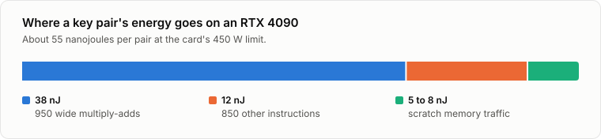

# Design

How the search works, why it is built the way it is, and what limits it on the GPUs it
has been measured on.

## The search

An onion address is `base32(pubkey || checksum || version)`, so a prefix is a condition
on the first bytes of the Ed25519 public key: the low bits of the point's `y` coordinate.
The search only ever computes (part of) `y`.

Each GPU thread owns a public point `C = a*B` for its own secret scalar `a`. A batch
tests the `2N+1` keys `C + j*G8`, `j = -N..N`, with `G8 = 8*B` (steps of 8 keep the
scalar a clamped Ed25519 scalar), then moves `C` by `(2N+1)*G8`.

With `Q_i = i*G8 = (x_i, y_i)` from a table shared by all threads, the two candidates of
a pair are, in affine twisted Edwards coordinates,

```
y(C + Q_i) = (A + B) / (1 - t)        A = y1*y_i   B = x1*x_i
y(C - Q_i) = (A - B) / (1 + t)        t = d*x1*y1*x_i*y_i = (x1*y1) * k_i
```

1. **One inversion per pair.** Both denominators divide `1 - t^2`, so with
   `inv = 1/(1 - t^2)` and `w = t*inv` the candidates are `(A+B)(inv+w)` and
   `(A-B)(inv-w)`. `1 - t^2 = 1 - (x1*y1)^2 * k_i^2` needs one multiplication by a
   table constant.
2. **Montgomery's trick** over the batch: one field inversion per `N` pairs, three
   multiplications per pair.
3. **The last two multiplications are probes.** Rejecting a candidate needs only the
   first 32 bits of `y`. For a product `f*g` those depend on the low halves of the two
   lowest columns and on the carry out of bit 255, which the two highest columns
   determine except in about one product in 4000. That case is detected and takes the
   full product.
4. **A carry chain without the wrap-around pass.** The carry out of bit 255 is estimated
   to within one before the chain and folded in up front, so one pass leaves limbs that
   pack into 256 bits with shifts alone.

A pair costs 8 multiplications, one squaring and two probes in the `lean` scratch mode:
about 4.6 multiplications per key (on an M5 Pro a squaring costs 0.57 of a
multiplication and a probe 0.35), plus the batch inversion.

**The inversion** is Bernstein and Yang's division steps in the arrangement of
libsecp256k1: 20 rounds of 30 steps on the low limbs, each applied to the full values as
one 2x2 matrix, on nine signed limbs of 30 bits. Nothing inverted is secret, so its
timing does not matter. On an M5 Pro it takes as long as 57 multiplications, a third of
the addition chain for `z^(p-2)` (254 squarings and 11 multiplications): 1% of a batch of
512 pairs, 0.6% of one of 1024.

## The client key search

A client authorization key is an x25519 public key: the `u` coordinate of a point of
the same curve in Montgomery form, `v^2 = u^3 + A u^2 + u`. The walk is the same, over
the same scalars, with centre `C = (u1, v1)` and table points `Q_i = (u_i, v_i)`:

```
u(C + Q_i) = ((v_i - v1) / (u_i - u1))^2 - A - u1 - u_i
u(C - Q_i) = ((v_i + v1) / (u_i - u1))^2 - A - u1 - u_i
```

The two share the inverse of `u_i - u1`, a denominator that takes a subtraction to form
where the address search multiplies. With Montgomery's trick a pair costs 5
multiplications and 2 squarings, 3.5 multiplications a key, and stores one running
product. The subtraction after the squaring rules out a probe: each candidate is carried
in full and its low 32 bits are tested.

It is a fourth variant of the kernel loop next to the three scratch modes, compiled on
its own, so it changes nothing about the address search. Measured against that search
it is 1.36 times as fast on an M5 Pro (Metal) and 1.35 to 1.40 times on a Radeon 610M
(Vulkan, ROCm).

## Scratch modes

The forward pass builds a running product of the denominators; the backward pass peels
one inverse off per pair and needs the forward pass's values again. How much is stored:

| mode | stored per pair | cost per pair |
|---|---|---|
| `full` | running product and `z*kappa_i`, 64 bytes | 8M |
| `lean` | running product, 32 bytes | 8M + 1S |
| `half` | running product of every second pair, 16 bytes | 8.5M + 1S |

Fast GPUs outrun their memory, slow ones do not, so the modes are measured at start-up.
The fastest wins; among modes within 2% of it, the one that needs least memory.

A thread's scratch slot is contiguous (`*_AOS=1` at build time). The alternative, one
word per thread side by side, is 10% slower on an RTX 4090 and up to a third slower on a
Radeon 610M.

## Field arithmetic

Elements of GF(2^255 - 19) are ten unsigned limbs in radix 2^25.5. The multiplication
exists twice behind one contract (`src/kernel/field.h`):

- **wide**: 100 products of 32x32 bits accumulated in 64-bit columns. A 32x32->64
  multiply-add is one instruction on NVIDIA (`IMAD.WIDE`) and cheap on Apple GPUs.
  Saturated 8x32 limbs, 5x51 limbs and precomputed multiples are all slower on an M5 Pro.
- **narrow** (`field13.h`): every limb is cut into two half-limbs of 13 or 12 bits. A
  product of two fits 27 bits, a column of twenty fits 32, and every term is one 24-bit
  multiply-add: 400 of them and about 200 instructions of splitting and carrying.

Narrow exists for AMD GPUs behind Mesa. On RDNA 2 a 32x32 multiply, either half of the
product, takes as long as 4.5 additions; a multiply of two values below 2^24 takes as
long as one and can absorb an addition. ROCm's compiler turns `column += (u64)a * b` into
one slow instruction (`v_mad_u64_u32`). Mesa's needs two slow multiplies and a
two-instruction carry.

| field multiplication on a Radeon 610M | wide | narrow |
|---|---|---|
| Vulkan (Mesa 25.2 and 26.2) | 3.97 ns | 2.16 ns |
| ROCm 6.4 | 1.67 ns | 2.61 ns, and miscompiled |

An RX 6700 XT behind Mesa agrees: 2.00 G keys/s narrow, 1.24 G wide.

Elsewhere narrow loses: an M5 Pro runs it at 0.42 of wide's speed, and on an RTX 4090 its
400 multiplies should cost twice the energy of 100 wide ones (not measured). So the
Vulkan backend carries both kernels, offers narrow first on AMD, measures both on GPUs
that are neither NVIDIA's nor Apple's, and uses wide on those two. ROCm is built wide.

**LLVM miscompiles narrow.** LLVM's AMD backend takes a sum of products of values masked
to 13 bits for a dot product of bytes and emits `v_dot4_u32_u8` (`handleMulOperand` in
`SIISelLowering.cpp` accepts an operand whose second byte it could not analyse). ROCm
6.4's hipcc and Mesa's LLVM path (`RADV_DEBUG=llvm`, LLVM 20.1) both do it. The start-up
self-test catches it: an arithmetic whose kernel does not find the keys planted for it is
dropped (`not using the narrow arithmetic: ...`) and the other one used.

`tools/gen_field13.py` writes `field13.h` and proves, by interval arithmetic over the
largest value of each operand class, that no column or carry overflows.

## Prefix filter

The kernel compares the first 32 bits of a key, then confirms survivors on 64 bits; the
host compares the full address.

| prefixes | first stage |
|---|---|
| up to 4 | mask-and-compare against launch parameters |
| 5 to 12 | the same with twelve slots, branch-free: about 70 instructions per pair, no memory access |
| more | an 8 KiB bit table on the first 16 bits, which stays in the cache next to the cores; the one key in 65536 per prefix that passes is looked up in two 2 MiB tables covering all 32 bits |

Every comparison is a mask and a value on key bits; nothing is encoded on the GPU. A
wildcard contributes the bits that all of its characters share: the top two for `?d`,
none for `?l` and `?a`. The kernel then reports a superset (a third more per `?d`, a
quarter more per `?l`) and the host decides on the text.

## Launches and hits

A launch runs a number of batches on every thread and returns hits as positions
`(thread, batch, index)`. A device records at most 4096 per launch and counts the rest.

For a very short prefix one launch holds more than that, so launches are sized for half
the buffer: fewer batches, then a window of the threads at a time. A launch that reports
more hits than it recorded is undone, its threads put back where they started from their
seeds, and run again in two halves of its batches or of its threads. No hit is lost.

## What limits each GPU

### NVIDIA RTX 4090

The card runs the search at its 450 W limit, so what counts is energy per key, not
instructions per key. A 32x32->64 multiply-add costs about three times an add (0.040 nJ
against 0.013), and a byte of scratch traffic about as much as three multiply-adds
(0.13 nJ).

<picture>
  <source media="(prefers-color-scheme: dark)" srcset="energy-dark.svg">
  
</picture>

With no scratch traffic at all (not a working configuration) the kernel reaches 17.7 G
keys/s, the ceiling for this algorithm on this card. Thread length, register limits and
block size all sit within a few percent. What matters:

- The scratch slot of the next pair is fetched one pair early (CUDA only), so its cache
  miss overlaps with arithmetic: 9%.
- The 32x32->64 products are spelled in PTX. Written in C, nvcc hoists the
  zero-extension of loop-invariant operands out of the loop and ptxas then emits a dead
  add after every product: 10%.
- 2048 threads per multiprocessor: 512 give 14.1 G keys/s, 1024 give 16.0, 2048 give
  16.6.
- `lean` scratch: 16.6 G keys/s against 15.0 for `half` and 13.9 for `full`, which
  saturates the memory bus.

Older cards are slower per multiprocessor: an RTX 3090 (82 of them), an RTX 2060 SUPER
(34) and a GTX 1650 SUPER (20) all do 83 M keys/s on each, the 4090 130 M. The 3090 is
fastest in `lean` scratch, level with `full`; the other two in `half`, by 2 to 7% over
`lean`. With Vulkan the 3090 does 6.09 G keys/s, 89% of its CUDA rate.

**Vulkan on NVIDIA.** The kernel is as fast as the CUDA one, but NVIDIA's driver cannot
cheaply preempt a running Vulkan compute dispatch. When a compositor wants to draw, the
dispatch in flight continues at about 1/17 of its speed until it ends, and one that then
needs more than several seconds gets the device reset (`Xid 109, CTX SWITCH TIMEOUT`).
On a 4090 that also drives a desktop, 250 ms launches stall for 4.4 s at a time and
500 ms launches lose the device. The backend keeps launches on NVIDIA to 50 ms, which
bounds a stall to under a second.

### AMD Radeon 610M

A 2-compute-unit RDNA 2 GPU that executes 276 G simple instructions a second. The search
is bound by instruction count: the narrow kernel takes about 6000 per key pair, ROCm's
wide one fewer.

- Fastest at 1024 to 2048 threads, a third slower at 16384. Vulkan cannot ask a device
  how wide it is, so on integrated GPUs it measures the thread count at start-up.
- Discrete cards have an optimum too, so Vulkan measures on them as well. A 40-unit RX
  6700 XT is fastest at 65536 threads: 5% ahead of 131072, 15% ahead of 16384. There
  `full` scratch beats `lean` by 8 to 10% at batches of 1024 pairs and more.
- ROCm is 5% faster with batches of 512 pairs than of 1024.
- The rate scales with the size of the GPU. The HIP runtime counts one multiprocessor
  here and 36 in an RX 6800 XT, which does 3.82 G keys/s: 106 M on each, close to the 108 M here. An
  RX 6700 XT, 20 of them, does 1.95 G keys/s with Vulkan: 98 M on each, against 93 M here.
- A function call makes this GPU spill its registers. hipcc compiles the whole kernel as
  one function in seconds, so the ROCm build inlines everything: 2%.

### Apple M5 Pro

Bound by arithmetic: `full` and `lean` scratch measure the same, so `lean` is used
without measuring. The first 20 seconds run at 1.7 G keys/s; a heat-soaked laptop
sustains 1.0 to 1.5 G.

## The kernel dialect

`src/kernel/` is written in the common subset of CUDA/HIP C++, the Metal Shading
Language, Vulkan GLSL and plain C++, so one source is compiled by nvcc, hipcc, the Metal
compiler, glslang and the host compiler. A handful of macros cover casts, buffers and
inlining; `defs.h` lists the rules.

## Source layout

```
src/kernel/defs.h       target abstraction, launch parameters
src/kernel/field.h      GF(2^255-19), wide multiplication
src/kernel/field13.h    narrow multiplication, written by tools/gen_field13.py
src/kernel/search.h     the per-thread search loop
src/kernel/entry_*      kernel entry points for Metal and Vulkan
src/backend_*           one per API; backend_cuda.cu is also the ROCm backend
src/engine.cpp          seeding, launches, hit validation, self-tests
src/keys.cpp            all secret-key handling (libsodium)
src/ed.cpp              public-point helpers and the kernel table
src/filter.cpp          prefixes to kernel filter tables
src/onion.cpp           SHA3-256, address encoding
src/platform.cpp        file and console calls for POSIX and Windows
tests/                  field, self-test and end-to-end tests
tools/                  generators for field13.h and the charts
Dockerfile*, docker/, cipollino-docker    container builds and the run wrapper
CMakeLists.txt, cmake/, vcpkg.json        the Windows build
```
